# Text-conditioned DiT-S/4 on MS-COCO

An adaptation of DiT (Peebles & Xie, 2023) that generates 256×256 images from text, using
adaLN-Zero-Text conditioning on VAE latents and CLIP embeddings. The original DiT license is
in `dit_base/LICENSE.txt`.

## Team

| Member                     | Contribution                                                                                          |
| -------------------------- | ----------------------------------------------------------------------------------------------------- |
| Linda Fei Payeras Olano    | Feature extraction and dataset                                                                        |
| Milagros Rodriguez Ventura | Text-conditioned model (`models.py`) and its tests + final clean up of the repository + documentation |
| David López Valdivia       | Training script and the training run                                                                  |
| Daniel Cruz Navarro        | Sampling, evaluation and analyses                                                                     |

## Results (EMA, 150,000 steps)

Training used 45,174 train2014 images containing people, cropped around them, with batch size 128. Evaluation used 10,000 val2014 images not filtered for people, with a center crop and a
single seed. This difference limits how the absolute values can be read.

| Sampler         |   s | FID-10K | CLIP L/14 | CLIP B/32 |
| --------------- | --: | ------: | --------: | --------: |
| DPM-Solver++ 20 |   1 |   98.44 |     15.35 |     21.07 |
| DPM-Solver++ 20 | 1.5 |   87.02 |     16.25 |     22.17 |
| DPM-Solver++ 20 |   2 |   79.05 |     16.92 |     22.93 |
| DPM-Solver++ 20 |   3 |   71.98 |     17.81 |     23.78 |
| DPM-Solver++ 20 |   4 |   71.22 |     18.27 |     24.11 |
| DPM-Solver++ 20 |   5 |   73.23 |     18.47 |     24.21 |
| DDPM 250        |   4 |   76.66 |     18.32 |     24.17 |

CLIP Score of the real images: 25.56 (L/14) and 30.15 (B/32).

### Effect of the CFG scale

s = 4 gives the lowest FID in the sweep, and s = 5 gives the highest CLIP Scores.

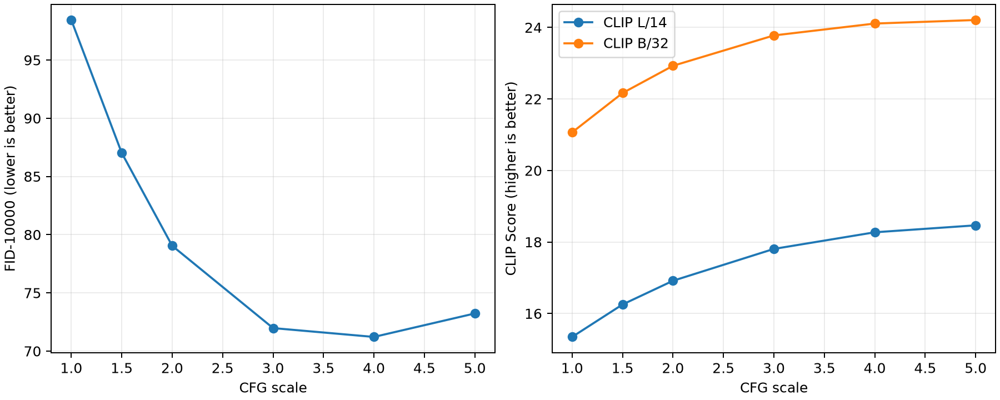

### Examples from the evaluation

These are the 8 examples kept with the evaluation, which were not selected for quality. Generated
images use DPM-Solver++ 20 with s = 4. They match the text only partly and show defects in shape
and composition.

| Caption                                                         | Real image                                                                                             | Generated                                                                                                              |
| --------------------------------------------------------------- | ------------------------------------------------------------------------------------------------------ | ---------------------------------------------------------------------------------------------------------------------- |
| A white plate with sausage, eggs and other meat.                | 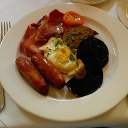 |  |
| A man walking into the ocean while holding a surfboard.         | 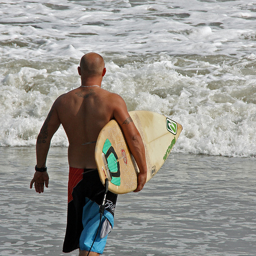 |  |
| A bird sitting in a field of beautiful purple flowers.          |  | 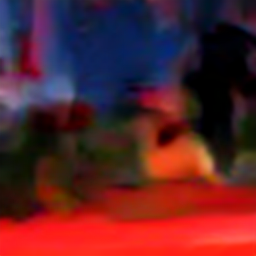 |
| A man and two women walking their dogs and hiking in the woods. | 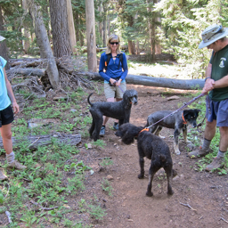 | 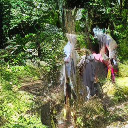 |
| A woman smiling while standing next to a giraffe.               | 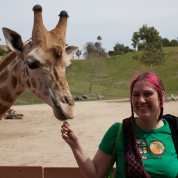 | 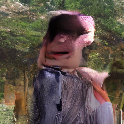 |
| A man on a horse watching another man wrestle a cow.            | 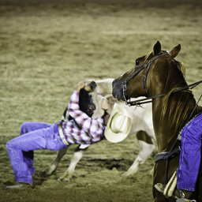 | 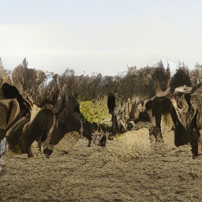 |
| Two giraffes are running through a bushy savannah.              | 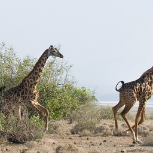 |  |
| A motorized cart fills a train with luggage                     | 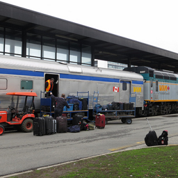 |  |

### Training grid at 150,000 steps

EMA, DPM-Solver++ 20, s = 4, seed 0. Grids for every 10,000 steps are in `outputs/training/samples/`.

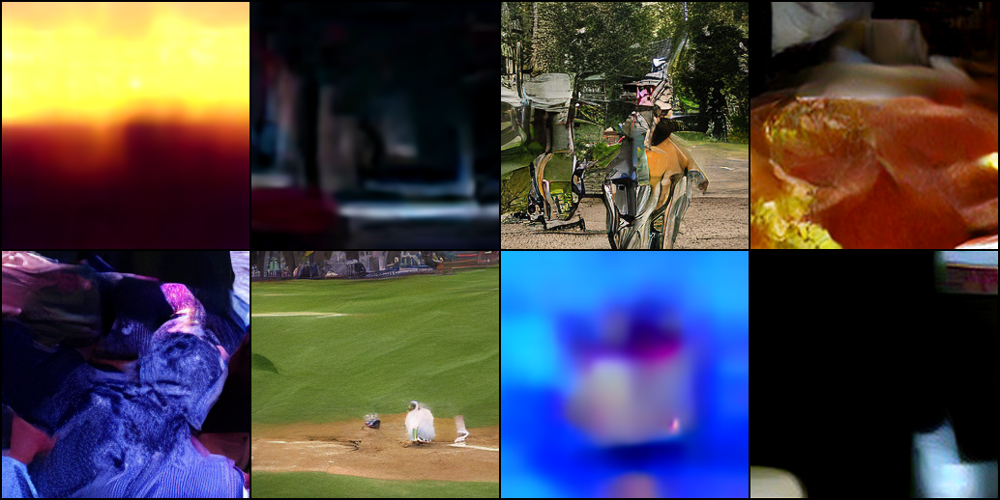

Prompts, left to right and top to bottom: a dog sitting on a beach at sunset; a red car parked in
front of a building; a woman riding a bicycle in a park; a plate of food on a wooden table; a cat
sleeping on a couch; a group of people playing baseball; an airplane flying over mountains; a vase
of flowers next to a window.

## Repository layout

```text
dit_base/   Paper code: diffusion/ (unchanged), models.py and download.py (adapted), LICENSE.txt
src/        New code: features, dataset, training, sampling and evaluation (eval/)
tests/      Tests
notebooks/  Tutorial notebook
outputs/    training/ (log and grids every 10K steps), evaluation/dit_s4_150k/ (metrics, traces, figures, examples)
```

| File in `src/`                                                                   | Purpose                    |
| -------------------------------------------------------------------------------- | -------------------------- |
| `extract_features.py`, `createCSV.py`, `make_null_embedding.py`, `text_utils.py` | VAE and CLIP features      |
| `dataset_t2i.py`                                                                 | Dataset over the features  |
| `train.py`                                                                       | Training                   |
| `sample_t2i.py`                                                                  | Image generation from text |
| `eval/`, `analyze_evaluation.py`, `report_evaluation.py`, `verify_evaluation.py` | Evaluation and analyses    |

## Tutorial notebook

[`notebooks/text_to_image_tutorial.ipynb`](notebooks/text_to_image_tutorial.ipynb) walks through the model step by step, and it
is stored with its outputs so you can read it without running anything: VAE latents, CLIP embeddings,
DiT-S/4 conditioning, a short training demonstration, generation from text, the guidance scale, and the stored results.

To run it, use the environment from step 1 below, then `pip install jupyter` and
`jupyter notebook notebooks/text_to_image_tutorial.ipynb`. It downloads the checkpoint and the CLIP and VAE
weights, and needs neither COCO nor a GPU.

## Reproducing the project

Run every command from the repo root. You do not need to run anything to read the results. The
full steps 2–6 take a long time: the recorded training took about 21 h and the evaluation
generates 72,000 images.

### 1. Environment and tests

With Python 3.11:

```bash
python3.11 -m venv .venv
source .venv/bin/activate
pip install -r requirements.txt
export PYTHONPATH="$PWD/dit_base:$PWD/src"
OMP_NUM_THREADS=2 python -m pytest tests -q
```

Expected result: 50 tests passed, and 1 skipped without CUDA. The `export` is needed in every
new terminal. These are the evaluation versions. The training versions were not recorded, so this
environment does not guarantee an identical training result.

### 2. Data

```bash
mkdir -p coco
curl -L -o coco/train2014.zip http://images.cocodataset.org/zips/train2014.zip
unzip -q coco/train2014.zip -d coco
python -m eval.fetch_coco --root coco --count 10000 --seed 0
unzip -qn coco/annotations_trainval2014.zip -d coco
```

`train2014.zip` is about 13 GB. `eval.fetch_coco` downloads the annotations and the 10,000 val2014
evaluation images. The last `unzip` adds `person_keypoints_*`, which feature extraction needs.
Do not train on train2017: it contains most of val2014.

### 3. Features

```bash
python src/extract_features.py
python src/createCSV.py
python src/make_null_embedding.py
```

These read `coco/` and write to `features/train/`. They only process images with people and 5
captions. `extract_features.py` always uses the CPU (`device = "cpu"`) and resumes unfinished work.
`make_null_embedding.py` creates `null_empty_string.npy`, but **`train.py` does not use it**.
According to David, the run's features came from this version of the extractor; this was not
independently verified.

### 4. Training

```bash
python src/train.py --feature-path features/train --results-dir outputs/runs \
  --max-steps 150000 --global-batch-size 128 --global-seed 0 \
  --lr 1e-4 --cfg-dropout 0.15 --use-amp auto
```

These are the arguments stored in the checkpoint, except `--results-dir`. Output goes to
`outputs/runs/NNN-DiT-S-4/`: `log.txt`, `checkpoints/` and `samples/`.

- **Device:** CUDA or CPU; MPS is not used.
- **Precision:** `--use-amp auto` enables bf16 on CUDA or on a CPU with AVX-512 BF16. Otherwise it
  runs in fp32. The original run used a CPU with bf16.

### 5. Generating images

```bash
python -m eval.fetch_checkpoint --output checkpoints/david/last.pt
python src/sample_t2i.py --ckpt checkpoints/david/last.pt \
  --prompt "A dog on a beach" --output outputs/runs/example \
  --sampler dpm --steps 20 --cfg-scale 4 --seed 0 --batch-size 8 \
  --allow-zero-null --device cpu
```

`--output` must be a folder that does not exist yet. `--device` accepts `cpu`, `mps`, `cuda` or `auto`.

### 6. Evaluation

```bash
python -m eval.prepare --captions coco/annotations/captions_val2014.json \
  --images-dir coco/val2014 --output outputs/runs/references_val2014_10k_seed0 \
  --count 10000 --seed 0 --preprocess center-crop

OMP_NUM_THREADS=2 python -u -m eval.execute_plan --ckpt checkpoints/david/last.pt \
  --manifest outputs/runs/references_val2014_10k_seed0/manifest.json \
  --output outputs/runs/reproduction_150k \
  --generation-device cuda --metric-device cuda --clip-device cuda \
  --batch-size 8 --metric-batch-size 32 --allow-zero-null
```

`execute_plan` generates the images and computes the metrics for the full sweep. For a single
configuration, use `eval.run generate` and `eval.run metrics`. The delivered evaluation ran on Apple
Silicon, so use `mps` for the three device options to match it.

The analyses need the full PNGs. So does `src/verify_evaluation.py`, which also depends on the
absolute paths stored in the traces, so it only works where those paths exist.
